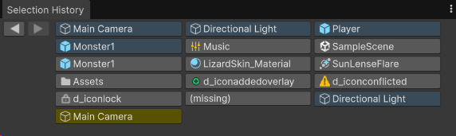

# Wise Selection History
Selection history that works with mouse back and forward buttons.

## Features
Use mouse back and forward button to navigate the selection history or open the selection history window via "Edit / Selection / History Window"
* Horizontal and vertical layout support.
* Mouse Back / Forward buttons step through the selection history.
* Drag entries into scene, project or inspector as if dragging the real objects.
* Drag entries to reorder.
* Pin entries for quick access with right-click context menu.
* Scene objects are tinted in blue. Changing scene clears them.
* Destroyed entries are shown as "(missing)".
* Copy names or paths with right-click context menu.


## Installation
* [Asset Store](https://u3d.as/4ht5)
* [OpenUPM](https://openupm.com/packages/devlocker.tools.wiseselectionhistory) support:
```
npm install -g openupm-cli
openupm add devlocker.tools.wiseselectionhistory
```
[](https://openupm.com/packages/devlocker.tools.wiseselectionhistory/)

* GitHub UPM package - merge this into your `Packages/manifest.json`
```
{
  "dependencies": {
    "devlocker.tools.wiseselectionhistory": "https://github.com/NibbleByte/UnityWiseSelectionHistory.git#upm"
}
```

## Notes
- On **Windows**, the mouse buttons are read directly, so they work in any editor window while Unity is the focused application.
- On **macOS and Linux**, the mouse buttons only work over the Scene view, the Hierarchy and the Project window.
- Pins are stored in `UserSettings/WiseSelectionHistoryPins.asset`.

## License
MIT. See [LICENSE](https://github.com/NibbleByte/UnityWiseSelectionHistory/blob/master/LICENSE).
